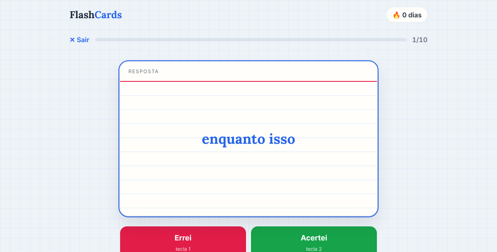

# FlashCards — Cartões de estudo

Sistema de cartões de estudo com frente e verso, embaralhamento, acertos e erros e revisão inteligente.

🔗 **[Ver o site no ar](https://iamviniciuslima05.github.io/PROJETO-FlashCards/)**



## Funcionalidades

- **Baralhos** com cartões de frente e verso
- Cartão que **vira** com animação (toque ou espaço)
- **Embaralhamento** automático
- Marcar **acerto ou erro** (teclas 1 e 2)
- **Revisão inteligente** com repetição espaçada (sistema Leitner)
- Modo para **revisar só os erros**
- Níveis de domínio de cada cartão
- **Colar vários cartões** de uma vez
- Dias seguidos estudando

## Tecnologias

HTML5 · CSS3 · JavaScript · localStorage

## Estrutura

```
index.html
css/style.css
js/script.js
```

## Como rodar

Não precisa instalar nada: baixe o projeto e abra o `index.html` no navegador, ou acesse a versão publicada acima.

---
Feito por **Vinicius Lima** · [Portfólio](https://viniciuslimadev.netlify.app) · [LinkedIn](https://www.linkedin.com/in/viniciuslima25/)
